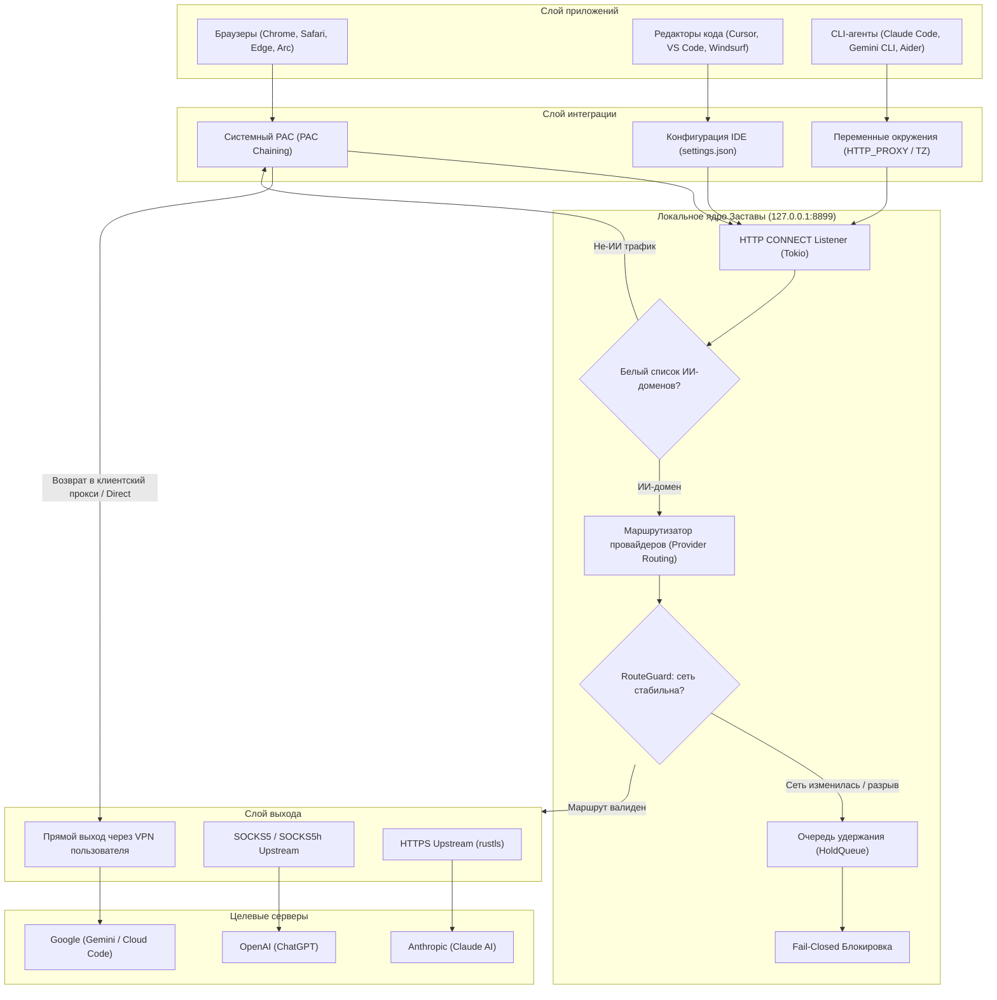

# Архитектура Застава v2.0.0

Документ описывает внутреннее устройство настольного приложения **Застава v2.0.0**, потоки данных, модульную структуру ядра на Rust и компонентную модель пользовательского интерфейса.

---

## 1. Общий стек и концепция

Застава построена на базе гибридного фреймворка **Tauri v2**:
* **Backend (Ядро)**: Rust (`src-tauri/`), многопоточный асинхронный рантайм Tokio, криптография и TLS на базе `rustls` и `ring`. Выполняет функции локального сетевого шлюза, инспектора маршрутов, аудитора сетевого окружения и менеджера системных прокси.
* **Frontend (Интерфейс)**: React 19, TypeScript, Vite, Tailwind CSS 4 (`src/`). Работает в изолированном WebView без прямого доступа к API операционной системы, взаимодействуя с ядром через типизированный IPC (`invoke` / `emit`).
* **Дизайн-система**: Zastava Design System (`src/ui/`, `src/styles/tokens.css`). Полная изоляция цветов через CSS-переменные (строго 0 «сырых» hex-цветов в компонентах).

---

## 2. Схема движения трафика



---

## 3. Модули ядра Rust (`src-tauri/src/`)

```
src-tauri/src/
├── main.rs            # Точка входа приложения
├── lib.rs             # Инициализация Tauri-плагинов, сборка стейта и регистрация IPC
├── app.rs             # Жизненный цикл десктопного окна и хуки событий
├── proxy/             # Локальный HTTP CONNECT шлюз и сетевой страж
├── routing/           # Модель маршрутов v2, парсинг ключей, SSRF-валидация
├── auditor/           # 12 контуров сетевой безопасности, Claude Vault, правила
├── sysproxy/          # Управление системным прокси OS, интеграция IDE и shell
├── commands/          # Тонкие IPC-хэндлеры Tauri, разбитые по доменам
├── state/             # Потокобезопасное состояние AppState и персистентность
├── tray/              # Нативное системное меню трея / меню-бара
├── updater/           # Логика проверки и безопасной установки обновлений
├── bin_checker/       # Локальная валидация префиксов платежных карт
└── sanctions.rs       # Проверка географических ограничений
```

### 3.1. `proxy/` — Сетевой шлюз и безопасность соединений
* **`server.rs`**: локальный асинхронный сервер на базе Tokio, слушающий `127.0.0.1:8899`. Принимает запросы `HTTP CONNECT`, проверяет целевой хост на принадлежность к поддерживаемым ИИ-платформам или пользовательскому белому списку, определяет маршрут и устанавливает сквозной сокетный туннель (`tokio::io::copy_bidirectional`).
* **`guard.rs` (`RouteGuard`)**: отслеживает сетевой отпечаток ядра ОС (`LocalRouteFingerprint`) через быстрый сокетный probe. При изменении шлюза по умолчанию или разрыве VPN немедленно замораживает соединения до подтверждения пользователем.
* **`hold_queue.rs` (`ConnectHoldQueue`)**: временный буфер соединений. Удерживает входящие клиентские запросы во время переключения маршрутов или кратковременных сетевых флуктуаций без аварийного сброса сессий.
* **`pac.rs`**: генератор файла автоматической настройки прокси (`proxy.pac`). Поддерживает **PAC Chaining** — сохраняет адрес предварительно настроенного прокси пользователя (v2rayN, Throne, Hiddify) и заворачивает на Заставу только целевые домены ИИ, а остальной трафик возвращает в клиентский прокси.
* **`upstream.rs`**: реализация клиентов для подключения к внешним точкам выхода:
  * Прямой SOCKS5 / SOCKS5h (с аутентификацией и без);
  * Стандартный HTTP CONNECT прокси;
  * Защищенный **HTTPS-прокси** на базе `tokio-rustls` (сквозной CONNECT внутри TLS-сессии до входной ноды).
* **`route_watch.rs` (`RouteWatch`)**: фоновый сторож, периодически опрашивающий статус и задержку активных upstream-маршрутов с автоматическим переключением на резервные узлы.

### 3.2. `routing/` — Маршрутизация по сервисам и ключи v2
* **`mod.rs`**: структура `Route`, реестр привязок сервисов (`provider_routes`), выбор приоритетного выхода (`Profile Route -> Provider Route -> Default Route`) и логика `fail-closed`.
* **`key.rs`**: парсер и валидатор ключей `zastava://` (версии 1 и 2) и прямых URL прокси. Поддерживает множественные входные точки (`entry[]`), метки, проверку заявленного IP выхода (`exit_ip`) и таймер экспирации. Обеспечивает маскирование паролей (`redacted_for_ui`).
* **`net.rs`**: строгая проверка целевых IP-адресов входных узлов (SSRF-защита: отсечение loopback, private ranges, link-local, cloud metadata `169.254.169.254`).

### 3.3. `auditor/` — 12 контуров безопасности и Claude Vault
* **`network.rs`**: параллельный опрос сетевых метаданных через независимые эндпоинты Cloudflare и IP-инфо сервисы, замер пинга и проверка DNS-резолверов.
* **`geo_matrix.rs`**: матрица доступности сервисов (какие страны разрешены для Anthropic, OpenAI, Google).
* **`dnsbl.rs`**: параллельный асинхронный DNS-запрос к 4 базам репутации (`Spamhaus ZEN`, `SORBS`, `Barracuda`, `DroneBL`).
* **`history.rs`**: учет истории внешних IP-адресов, реализация `IP Pinning` (фиксация доверенного узла) и выявление аномально быстрых смен географических локаций (`Impossible Travel`).
* **`leaks.rs` & `os_env.rs`**: проверка утечек IPv6 в обход туннеля, согласованности часовых поясов (`TZ`) и региональных настроек системы (`Locale Hygiene`).
* **`rules.rs`**: авто-правила — сохранение и автоматическое применение настроек при подключении к известным сетям (Wi-Fi SSID/BSSID).
* **`cache_cleaner.rs`**: глубокая очистка сессионных меток и сетевых кэшей Electron (Claude Desktop, ChatGPT) с защитой пользовательских конфигураций MCP-серверов.
* **`profile_switcher.rs`**: изоляция профилей Claude Desktop. Генерация уникальных идентификаторов `device_id` в `ant-device-registry.json` и раздельное хранилище профилей.
* **`claude_exporter.rs`**: экспорт контекста Claude Code (`~/.claude`), парсинг сессий, планов и долгосрочной памяти (`MEMORY.md`), генерация сводной карты и универсального файла `RESTORE_PROMPT.md`.

### 3.4. `sysproxy/` — Системная интеграция
* **`macos.rs`**: взаимодействие с системной службой конфигурации сети macOS через `networksetup` (установка PAC-URL для всех активных интерфейсов).
* **`windows.rs`**: интеграция с реестром Windows и библиотекой WinINet с обязательным флагом `CREATE_NO_WINDOW` для исключения мерцания консоли `cmd.exe`.
* **`ide.rs`**: автоматическое чтение и обновление параметров `http.proxy` и `http.proxySupport` в файлах конфигураций VS Code, Cursor и Windsurf.
* **`shell_rc.rs`, `cli_protection.rs`, `ai_cli.rs`**: безопасная установка переменных `HTTP_PROXY`, `HTTPS_PROXY`, `ALL_PROXY`, `NO_PROXY` и `TZ` в `~/.zshrc`, `~/.bashrc`, `~/.zshenv` и профили PowerShell.
* **`cleanup.rs`**: централизованный модуль гарантированной очистки. Сбрасывает любые установленные прокси-настройки при нормальном выходе, сигнале завершения (SIGINT/SIGTERM) или перехвате паники ядра Rust (`std::panic::set_hook`).

### 3.5. `commands/` — Тонкие IPC-хэндлеры
Каждый файл в `commands/` группирует команды по функциональной области:
* `routes.rs` — добавление, удаление, привязка маршрутов и валидация ключей;
* `sysproxy.rs` — включение/выключение системного PAC, интеграция терминала и IDE;
* `audit.rs` — запуск 12 контуров сетевого аудита;
* `claude.rs` — операции Claude Vault (переключение профилей, бэкап контекста);
* `crash_test.rs` — выполнение симуляции разрыва VPN;
* `upstream.rs` — управление legacy upstream-прокси;
* `domains.rs` — чтение и редактирование белого списка доменов;
* `updates.rs` — проверка обновлений;
* `interception.rs` — параметры поведения всплывающего окна перехвата.

---

## 4. Архитектура фронтенда (`src/`)

```
src/
├── main.tsx           # Точка входа React
├── App.tsx            # Корневой роутер экранов и глобальные провайдеры
├── ui/                # Атомарные компоненты дизайн-системы (0 сырых hex)
├── features/          # Модульные экраны приложения
│   ├── overview/      # Экран «Обзор» (StatusHero, TrustRing, быстрые действия)
│   ├── connect/       # Экран «Подключение» (маршруты, ключи, ноды)
│   ├── checks/        # Экран «Проверки» (12 контуров аудита)
│   ├── backup/        # Экран «Бэкап» (Claude Vault, экспорт памяти, кэш)
│   ├── guides/        # Экран «Гайды» (VPS, TZ, платежная гигиена)
│   ├── onboarding/    # 4-шаговый мастер первого запуска
│   ├── alert/         # Автономное окно оповещения об обрыве VPN
│   ├── crash-test/    # Модальное окно интерактивного краш-теста
│   ├── subscription/  # Валидатор BIN карт и таймер прогрева
│   └── settings/      # Окно настроек приложения
├── shared/            # Общие хуки, утилиты форматирования, типы
│   ├── hooks/         # Кастомные React-хуки (useGatewayState, usePinning, ...)
│   ├── lib/           # Форматирование стран, дат, парсеры
│   └── version.ts     # Экспорт версии приложения
└── styles/            # Дизайн-токены, шрифты и стили
    ├── tokens.css     # Палитра цветов, радиусы, тени, анимации
    ├── fonts.css      # Локальные шрифты (Golos Text + JetBrains Mono)
    └── zastava.css    # Глобальные базовые стили
```

### 4.1. Принципы изоляции дизайн-системы
1. **0 сырых hex-цветов**: во всех файлах `src/ui/` и `src/features/` запрещено использование шестнадцатеричных цветов (`#rrggbb`) и прямых функций `rgb()` / `rgba()`.
2. **Токенизация**: все цвета определены в `src/styles/tokens.css` и используются исключительно через семантические CSS-переменные (`var(--bg-canvas)`, `var(--text-primary)`, `var(--accent-emerald)`, и др.).
3. **Автоматический контроль**: скрипт `scripts/check-no-hex.mjs`, запускаемый командой `pnpm lint:hex` и проверяемый в CI GitHub Actions, блокирует внесение нетокенизированных стилей.

---

## 5. Модель потокобезопасности и персистентности

* Все изменяемые глобальные данные ядра инкапсулированы в `AppState` (`src-tauri/src/state/mod.rs`) под защитой `tokio::sync::RwLock`.
* Персистентное состояние сохраняется в `state.json` в домашней папке пользователя (`~/.config/zastava/state.json` на macOS/Linux или `%APPDATA%\zastava\state.json` на Windows).
* При чтении выполняется валидация поля `schema_version`. Поддерживаются автоматические миграции конфигураций ранних версий (v1.x -> v2.0) без потери пользовательских настроек и списков профилей.
