<div align="center">
  

  # Застава (`Zastava`) v2.0.0

  **Бесплатный локальный сетевой экран и маршрутизатор трафика для работы с Claude, ChatGPT, Cursor, Antigravity, Gemini и CLI-агентами без блокировок аккаунтов, потери чатов и утечек IP/гео**

  [](https://github.com/kingbest1195/ai-antiban/releases/latest)
  [%20%7C%20Windows%2010%2F11-18181b?style=for-the-badge)](#быстрая-установка)
  [](#почему-это-безопасно-zero-mitm-чаты-не-читаются)
  [](LICENSE)

  <p align="center">
    <a href="https://github.com/kingbest1195/ai-antiban/releases/latest"><b>⬇ Скачать установщик (.dmg / .exe)</b></a> ·
    <a href="#реальные-боли-которые-закрывает-застава">Зачем ставить</a> ·
    <a href="#как-выглядит-и-работает-застава-20">Скриншоты v2.0</a> ·
    <a href="#12-проверок-до-отправки-промпта">12 проверок сети</a> ·
    <a href="#почему-это-безопасно-zero-mitm-чаты-не-читаются">Приватность</a> ·
    <a href="#сборка-из-исходников">Сборка</a>
  </p>
</div>

---

<p align="center">
  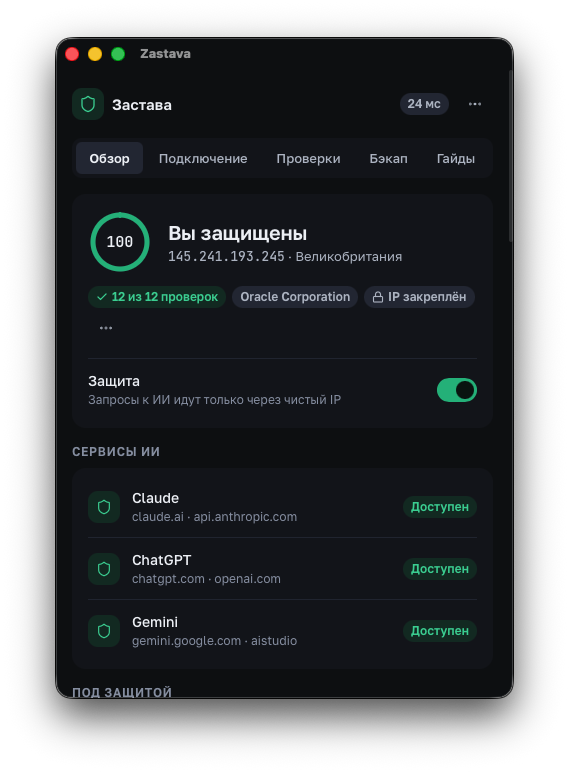
  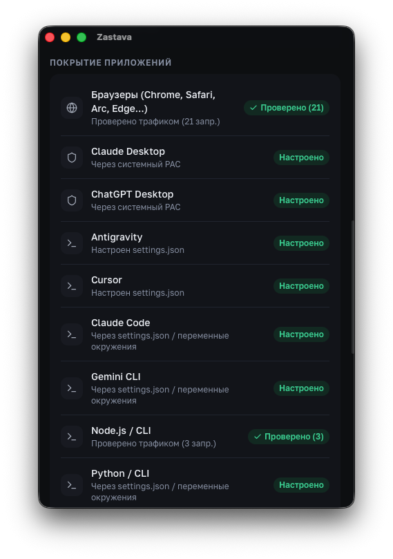
  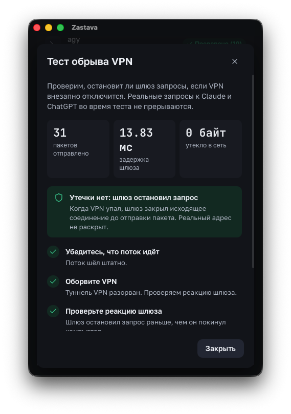
</p>

---

## Реальные боли, которые закрывает «Застава»

Даже с включённым платным VPN аккаунты **Claude Pro ($20)**, **ChatGPT Plus** и **Cursor** регулярно прилетают в бан без возврата средств. Причина почти всегда техническая и происходит незаметно для пользователя:

1. **Микро-обрыв VPN на 50–200 мс (`Kill-Switch Gap`)**
   Провайдер на долю секунды глушит протокол или переключается Wi-Fi. Браузер этого даже не замечает, но открытый фоновый сокет `Claude Desktop`, `Cursor` или `Claude Code` успевает отправить **один пакет с вашего домашнего IP**. Этого достаточно для автоматического флага антифрода.
   * **Что делает Застава:** держит локальный шлюз на `127.0.0.1:8899`. При малейшем сбое маршрута или смене IP шлюз замораживает запрос за **~13 мс (0 байт утечки наружу)** и показывает окно удержания.

2. **Рассинхрон часового пояса (`UTC+3 MSK` при европейском IP) и Wi-Fi геолокации**
   Антифрод Anthropic и Stripe сверяет географию IP-адреса с системным временем (`TZ`), локалью терминала и системной геолокацией по MAC-адресам соседних Wi-Fi роутеров. Несовпадение таймзоны повышает вероятность блокировки с **31% до 48%**.
   * **Что делает Застава:** проверяет все 12 параметров за 1 секунду и **в 1 клик синхронизирует часовой пояс (`TZ`) и локаль** только для ИИ-приложений, IDE и терминала — не сбивая системные часы на вашем Mac или Windows.

3. **Цепной бан всех аккаунтов на одном ноутбуке (`ant-device-registry`)**
   Если один аккаунт в `Claude Desktop` заблокировали, покупка новой почты и смена VPN не спасут: приложение хранит на диске скрытый идентификатор устройства (`device_id`) и общий кэш сессий. Второй аккаунт блокируется по цепочке.
   * **Что делает Застава:** во вкладке **«Бэкап»** создаёт изолированные профили с разными `device_id`, отдельными куками и привязкой к своему IP, а также в 1 клик сохраняет все ваши проекты, сессии и память Claude (`~/.claude`) в архив с готовым промптом переноса.

4. **Конфликты VPN, падение скорости и неработающие банки**
   Включать тяжёлый VPN на всю систему неудобно: перестают открываться российские банки и сервисы, режется скорость торрентов и загрузок, а два VPN-клиента перетирают системный прокси друг друга.
   * **Что делает Застава 2.0:** через **цепочку системного PAC (`PAC Chaining`)** и раздельные маршруты (`routes`) направляет через защиту **только домены ИИ**, бесконфликтно работая поверх любого вашего VPN (`Amnezia`, `Throne`, `Hiddify`, `v2rayN`, `WireGuard`).

---

## Быстрая установка

Установщики собираются автоматически в открытом GitHub Actions из исходного кода этого репозитория:

| Платформа | Установщик | Как поставить |
| :--- | :--- | :--- |
| **macOS** *(Apple Silicon M1–M4 и Intel)* | **[Скачать `.dmg` (v2.0.0)](https://github.com/kingbest1195/ai-antiban/releases/latest)** | Откройте `.dmg`, перетащите **Zastava** в `Applications`. Если macOS спросит подтверждение (сборка без платного сертификата Apple), выполните в Терминале:<br>`xattr -cr /Applications/Zastava.app` |
| **Windows 10 / 11** *(x64)* | **[Скачать `-setup.exe` / `.msi` (v2.0.0)](https://github.com/kingbest1195/ai-antiban/releases/latest)** | Запустите установщик. Работает полностью бесшумно в фоне (без всплывающих окон `cmd` и без записи глобальных переменных в `HKCU\Environment`). |

> **Уже установлена версия 1.3.x?** Просто откройте меню `···` в правом верхнем углу Заставы → **«Проверить обновления»** — приложение обновится до `v2.0.0` и перезапустится автоматически.

---

## Как выглядит и работает Застава 2.0

### 1. Три контура защиты и живой радар «Покрытие приложений»
На главном экране вы управляете тремя независимыми контурами:
* **Браузеры** (`Chrome`, `Safari`, `Arc`, `Edge`, `Яндекс`, `Firefox`, `Brave`) — через умный системный PAC.
* **Десктопные приложения** (`Claude Desktop`, `ChatGPT Desktop`) — перехват трафика без сертификатов + сброс антифрод-меток.
* **IDE и терминал** (`Antigravity`, `Cursor`, `VS Code`, `Windsurf`, `Claude Code`, `Gemini CLI`, `Codex`) — автоматическая прописка прокси в `settings.json` и профили оболочки с проверкой живости порта.

Ниже расположен **радар «Покрытие приложений»**: Застава сопоставляет входящие сокеты на `127.0.0.1:8899` с процессами ОС и показывает по факту, какие приложения прямо сейчас ходят через защиту и сколько запросов проверено.

<p align="center">
  
  
  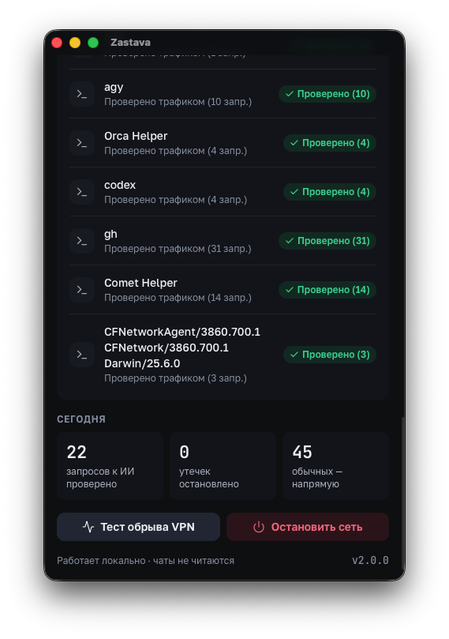
</p>

---

### 2. Перехват обрывов за 13.8 мс и встроенный краш-тест VPN
Не нужно верить на слово, что защита сработает в критический момент:
* Нажмите **«Тест обрыва VPN»** на главном экране — Застава проведёт боевую симуляцию падения туннеля и покажет точное время реакции шлюза (`~13.8 мс`) и количество утекших байт (`0 байт`).
* Когда в реальной жизни отвалится VPN или сменится IP, перед отправкой промпта появится компактное окно **«Запрос к ИИ приостановлен»** с управлением горячими клавишами `1` / `2` / `3` (либо сработает тихая авто-пауза без всплывающих окон).

<p align="center">
  
  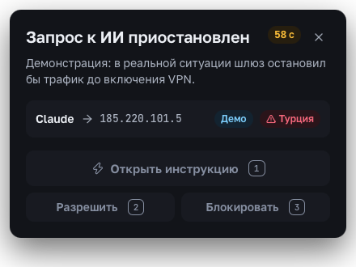
</p>

---

### 3. Вкладка «Проверки»: 12 контуров аудита до открытия чата
Перед тем как вы отправите первый запрос в Claude или оплатите подписку в Stripe, Rust-ядро проверяет соединение по 12 параметрам:

<p align="center">
  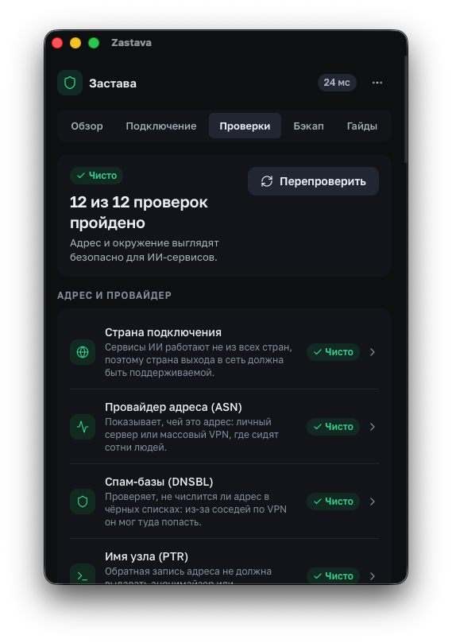
  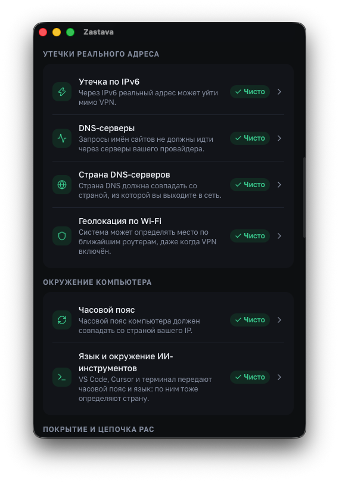
</p>

| № | Проверка | Что именно контролируется |
| :-: | :--- | :--- |
| **01** | **Страна подключения** | Поддерживается ли регион выходного IP целевым сервисом (`Anthropic`, `OpenAI`, `Google Gemini`). |
| **02** | **Провайдер адреса (`ASN`)** | Выявление заспамленных массовых VPN-подсетей и хостингов с высоким фрод-скором. |
| **03** | **Спам-базы (`DNSBL`)** | Параллельный опрос `Spamhaus ZEN`, `SORBS`, `Barracuda`, `DroneBL`. |
| **04** | **Имя узла (`Reverse DNS PTR`)** | Проверка обратной записи IP на маркеры публичных прокси и анонимайзеров. |
| **05** | **Закреплённый IP (`IP Pinning`)** | Защита от тихой смены выходного сервера (`Strict Pinning` блокирует трафик при смене IP). |
| **06** | **Скачки стран (`Impossible Travel`)** | Контроль резкой смены географии сессий за короткий промежуток времени. |
| **07** | **Утечка по `IPv6`** | Проверка, не уходит ли трафик в обход IPv4-туннеля через открытый стек IPv6 провайдера. |
| **08** | **Системные `DNS`-серверы** | Инспекция `scutil --dns` (macOS) и адаптеров Windows на утечки запросов к провайдеру РФ. |
| **09** | **Страна `DNS`-серверов** | Совпадение географии резолверов со страной выходного IP. |
| **10** | **Геолокация по `Wi-Fi`** | Предупреждение, если системные службы геолокации ОС выдают реальное положение по роутерам. |
| **11** | **Часовой пояс (`Timezone`)** | Сверка системного времени с таймзоной IP + **исправление в 1 клик** для ИИ-инструментов. |
| **12** | **Язык и окружение CLI/IDE** | Контроль переменных `TZ`, `LANG`, `LC_TIME` в терминале и редакторах кода. |

---

### 4. Вкладка «Бэкап»: сохранение памяти Claude и изоляция аккаунтов
* **Архив Claude в 1 клик:** собирает все локальные проекты, историю сессий (`.jsonl`) и файлы памяти из `~/.claude` в архив на Рабочем столе + формирует готовый промпт переноса (`Скопировать промпт переноса`), чтобы за секунду развернуть весь контекст на новом аккаунте или в другом ИИ.
* **Отдельные профили Claude Desktop:** переключение между аккаунтами с подменой `device_id`, изоляцией cookies и привязкой своего ключа/IP к каждому профилю.
* **Сброс кэша и меток устройства:** точечная зачистка антифрод-реестров `Claude Desktop` и `ChatGPT Desktop` без удаления ваших MCP-серверов (`claude_desktop_config.json`).

<p align="center">
  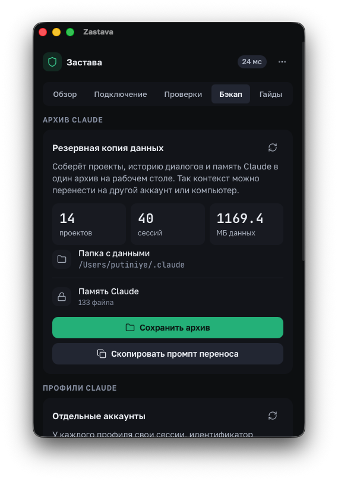
  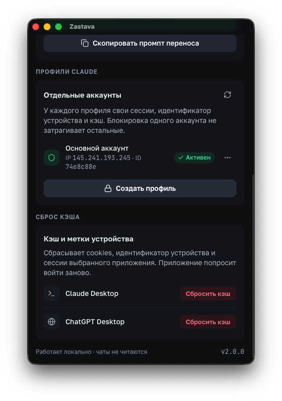
</p>

---

### 5. Вкладки «Подключение» и «Гайды»: маршруты по сервисам, свой VPS за 15 минут и оплата без отказов
* **Маршруты по сервисам (`routes`) и ключи `zastava://` v2:** привязывайте отдельные прокси/ключи (`HTTPS` на `rustls`, `SOCKS5`, `HTTP`) к конкретным сервисам (например, `Claude` — через выделенный сервер в Германии, `ChatGPT` — через текущий VPN). Режим **`fail-closed`** и сторож туннелей **`RouteWatch`** гарантируют: если ключ истёк или узел упал, трафик никогда не откатится на ваш домашний IP.
* **Пошаговые гайды внутри приложения:**
  * Как за 15 минут поднять личный чистый VPS (от ~180 ₽/мес с оплатой картой РФ / СБП) через **Amnezia (без кода)** или **VLESS в 1 команду**.
  * Платежная гигиена, проверенные сервисы зарубежных виртуальных карт, встроенный **BIN-чекер** по первым 6 цифрам карты, генератор безналогового адреса США (`0% Sales Tax` — экономит $2 с подписки) и 96-часовой таймер прогрева аккаунта (в меню `···` → «Подписка»).

<p align="center">
  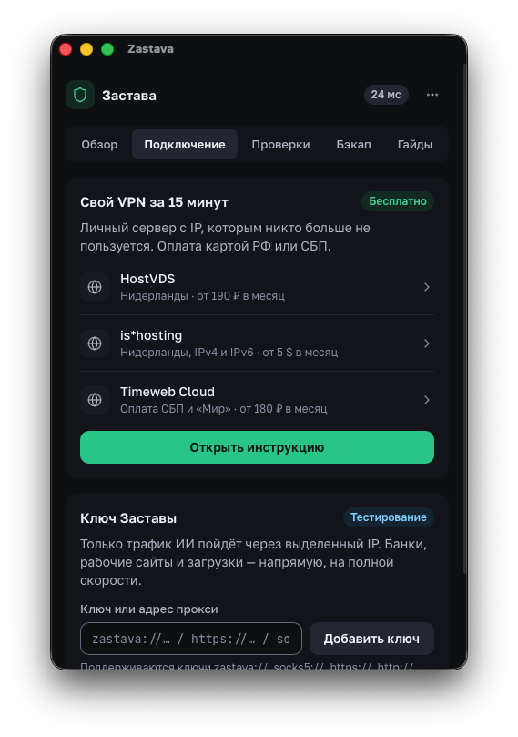
  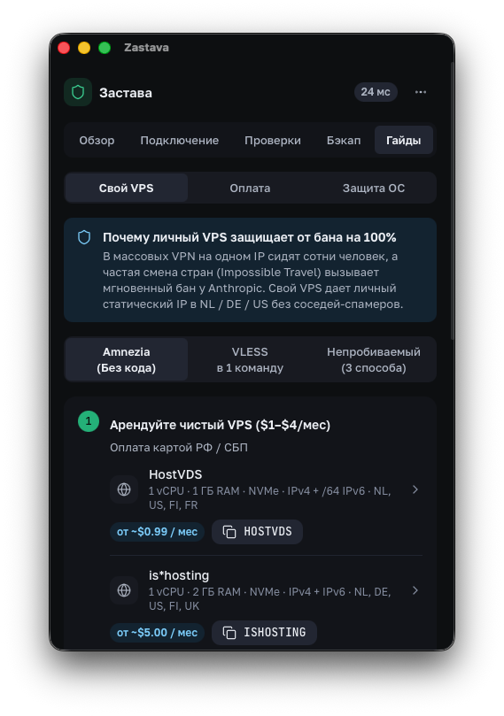
  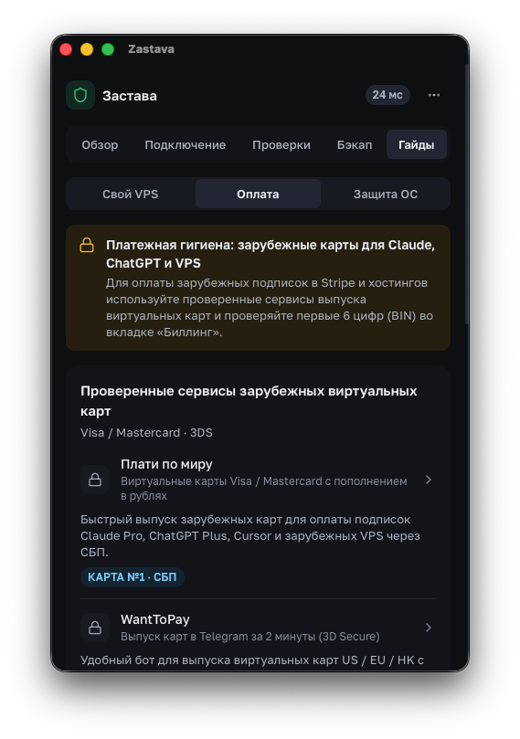
  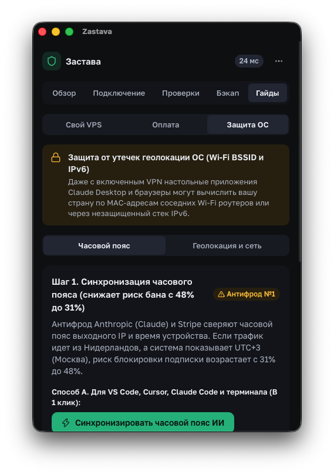
</p>

---

## Почему это безопасно: Zero-MITM, чаты не читаются

Застава создавалась разработчиками для собственной ежедневной работы с кодом и приватными проектами:

```
[Браузер / Claude Desktop / Antigravity / Cursor / CLI]
                         │
                         ▼  HTTP CONNECT host:443 (виден ТОЛЬКО домен, без расшифровки)
             [Локальный шлюз 127.0.0.1:8899]  ◄── Проверка 12 гейтов + сторож RouteWatch
                         │
                         ▼  Сквозной зашифрованный TLS-туннель (End-to-End)
        [Ваш VPN / Выделенный маршрут HTTPS·SOCKS5]
                         │
                         ▼
         [Серверы Anthropic / OpenAI / Google]
```

* **Никаких корневых сертификатов (`Zero-MITM`):** Застава **не устанавливает** Root CA в систему и физически **не может расшифровать** ваш TLS-трафик. Промпты, исходный код, файлы и API-ключи идут сквозным шифрованием напрямую до серверов ИИ.
* **100% локально, 0 аналитики (`Zero-Telemetry`):** в коде нет внешних серверов статистики, трекеров или рекламных SDK. Все настройки лежат локально в `~/.config/zastava/` (`%APPDATA%\zastava\`).
* **Строгая защита от `SSRF` и `DNS Rebinding`:** шлюз пропускает только белый список доменов ИИ, блокирует обращения к локальным подсетям и проверяет разрешённые IP до открытия сокета.

---

## Сборка из исходников

Требования: **Node.js 22+**, **pnpm 9+**, **Rust stable** (`cargo`).

```bash
git clone https://github.com/kingbest1195/ai-antiban.git
cd ai-antiban
pnpm install

# Прогон 139 unit и интеграционных тестов ядра Rust
cargo test --manifest-path src-tauri/Cargo.toml

# Проверка чистоты дизайн-системы (0 сырых hex-цветов) и сборка фронтенда
pnpm lint:hex && pnpm build

# Запуск в режиме разработки или сборка установщика (.dmg / .exe)
pnpm tauri dev
pnpm tauri build
```

* **Документация:** [ARCHITECTURE.md](ARCHITECTURE.md) · [SECURITY.md](SECURITY.md) · [PRIVACY.md](PRIVACY.md) · [CONTRIBUTING.md](CONTRIBUTING.md) · [CHANGELOG.md](CHANGELOG.md)
* **Лицензия:** [MIT](LICENSE)
